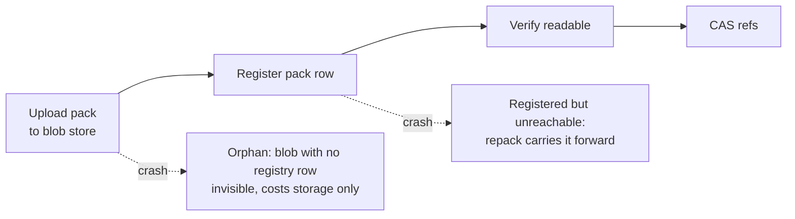

# The storage engine: immutable packs, ref CAS, and garbage

**TL;DR:** pack bytes are published before any ref can point at them. A crash can leave
extra bytes, never a dangling ref. A careful sweeper later reclaims unregistered and
superseded blobs; registered but unreachable objects stay until repository purge. That
explains what operators see: orphan blobs, retained bytes, repacks that keep unreachable
objects.
Procedures: [storage lifecycle how-to](../how-to/storage-lifecycle-and-sweeping.md).
Topology: [production guide](../how-to/deploy-production.md).

## Two stores, one invariant

| Store | Local mode | Holds | Guarantee |
|---|---|---|---|
| **Database** (Postgres) | SQLite | The *authority*: refs, pack registry, metadata, quota accounting | Refs advance only through compare-and-swap: each writer states the value it expects, and exactly one concurrent writer wins. |
| **Blob store** (S3-compatible) | Plain files | *Immutable, content-addressed packs* | Bytes under a key never change. Replicas racing the deliberately non-atomic exists-check may re-PUT *identical* content: harmless, but on a versioned bucket each re-PUT leaves a billed noncurrent version ([lifecycle rules](../how-to/deploy-production.md#backing-services)). |

An experimental third backend collapses both into one bucket
([below](#the-zero-infrastructure-backend-s3-as-sole-authority-s3wal)).

The one invariant across both is **publish before CAS**:

> Pack bytes are durably published to the blob store *before* any database row (pack
> registration, ref CAS) references them.

Every writer honors it:

- **Git pushes** upload and register quarantined packs in the pre-receive hook; the
  update hook CASes refs only after pre-receive succeeded.
- **REST writes** (commit-pack, merge, notes, fork) run the same upload → register → CAS
  pipeline.
- **Repack** publishes its consolidated pack before swapping registry rows.

After registering, writers verify the blob is readable (`blob.EnsurePublished`), backing
up the [sweeper](#why-deletion-is-so-careful).



**Crash asymmetry:** a crash between publish and commit leaves only extra bytes: an
unregistered blob (an **orphan**, which the sweeper can reclaim) or, after
registration, a registered but unreachable pack that repack carries forward. The write
path never produces a committed ref to unpublished bytes.
With destructive sweeping enabled, rare delete/registration races can make a registered pack *transiently*
unavailable; the quarantine handshake and every sweep's opening heal pass restore it. The
exposure is a bounded retry window, never durable loss. Orphans are cheap and
reclaimable; durably dangling refs would be data loss.

So **garbage is normal**. Crashed pushes, lost races, and superseded packs leave blobs by
design. An asynchronous [sweeper](#why-deletion-is-so-careful) reclaims them; the write
path never deletes synchronously.

## Storage compatibility and qualification

`OPENSTORAGE_S3_URL` selects the **blob** store, not the ref authority. With a Postgres
or SQLite ref store, S3 holds packs and LFS bytes. A `s3wal://` ref-store URL selects
**experimental S3WAL authority** and requires an S3 blob URL alongside it
([configuration](../reference/configuration.md#openstorage_pg_url)). Blob compatibility
never implies authority qualification.

**Blob capabilities** used by the [S3 implementation](../../internal/blob/blob.go) and
[shared transfer path](../../internal/blob/file.go): path-style AWS SigV4;
PUT/GET/HEAD/DELETE; paginated prefix LIST; multipart uploads; byte-range GET; ETag/size
metadata; server-side COPY (multipart copy for objects over 5 GiB). LFS downloads use
presigned GET URLs; uploads go through the application proxy. Successful publication must
be readable, and quota accounting relies on listings including published objects. Basic
PUT/GET/DELETE/LIST success does not establish compatibility: validate the capabilities
used and the [permissions and bucket configuration](../how-to/deploy-production.md#backing-services).

**Authority capabilities:** all blob requirements, plus

- atomic conditional PUT (`If-None-Match: *` create; `If-Match` advance, exactly one
  concurrent winner);
- ETag-based conditional GET/304;
- strong read-after-write and list-after-write consistency;
- byte-ordered paginated LIST with prefix/`StartAfter`;
- reliable store HTTP `Date` witnesses for expiry decisions.

The [startup probe](../../internal/ref/s3wal/probe.go) checks conditional writes, and
[startup refuses a missing usable Date witness](../../internal/ref/s3walstore.go).
Neither proves deployment-wide consistency or reliable time under all failures.
Conditional DELETE is **not** a correctness requirement or guard.

> [!WARNING]
> Never front the authority with a cache. Keep versioning and object lock disabled.

The first row needs the blob capabilities; every S3WAL authority row needs blob plus
authority capabilities.

| Surface / store | Observed evidence (version/configuration scoped) | Support / status |
|---|---|---|
| Ordinary S3 blobs with PG/SQLite authority | SeaweedFS is the [CI reference](../reference/testing.md#test-lanes). Historical [4.42 / legacy MinIO results](../plans/s3wal-phase1a-results.md#5-r7-store-qualification-matrix) cover specific transfer surfaces, not every blob operation/configuration. | AWS S3 is the primary target; SeaweedFS the tested self-hosted reference. Other endpoints, including MinIO, are untested/best-effort for this use, not blanket product endorsements. |
| AWS S3 as S3WAL authority | [22/22 require-mode verdicts](../plans/s3wal-bench-data/qualify-transcript-real-s3-2026-08-27.txt), eu-central-1, 2026-08-27; dedicated bucket, versioning/object lock off. [Campaign scope](../plans/s3wal-bench-results.md#environment): `52ea5c02` + PR #180's boot fix; one day, compute near but not in-region. | **Experimental.** Conditional future promotion target only. Historical evidence, not current-release AWS qualification. |
| SeaweedFS as S3WAL authority | [Phase 1a](../plans/s3wal-phase1a-results.md#environment): 4.42, 2026-08-25. Current [fixture pin/config](../../internal/ref/s3wal/s3waltest/s3waltest.go): 4.53, `weed server -s3`, anonymous gateway with signed fixture requests, versioning/object lock off; [require-mode lane](../../internal/ref/s3wal/qualify_test.go). | **Experimental.** CI reference and conditional future promotion target; no claim for arbitrary releases or deployment topologies. |
| MinIO as S3WAL authority | [Legacy `RELEASE.2024-01-16T16-07-38Z`](../plans/s3wal-phase1a-results.md#5-r7-store-qualification-matrix) ignored duplicate `If-None-Match: *` creation; stale `If-Match` advance did pass. The boot probe refused it. | **Not qualified for S3WAL authority.** Not a verdict on every past/future MinIO release; blob acceptance is separate. |
| Other S3 endpoints / emulators as S3WAL authority | No deployment qualification established here. Even [Floci `2.4.0`](../reference/testing.md#the-floci-s3-lane)'s require-mode/overwrite tests are regression coverage, not promotion evidence. | **Not qualified for S3WAL authority.** Passing a probe or selected tests does not confer support. |

The [qualification harness](../../internal/ref/s3wal/qualify_test.go) fails non-pass
verdicts in require mode; the legacy MinIO record-mode lane records incompatibilities
without certifying the endpoint. A green test job does not mean every recorded store
passed. That MinIO lane is [opt-in](../reference/testing.md#legacy-minio-lane-opt-in)
because upstream withdrew its image, so default CI does not run real MinIO.

**Conditional policy, not promotion.** AWS S3 and SeaweedFS are the intended future
promotion targets for [#192 G1](https://github.com/coder/openstorage/issues/192), subject
to the remaining qualification, correctness, operations, and release-specific coverage
gates. A1–A3's conformant real-S3 starvation rerun, separate-day repeats, and in-region
campaign are not established as passed. **All S3WAL targets remain experimental** within
the unchanged
[single-node boundaries](../how-to/deploy-production.md#zero-infrastructure-mode-experimental-one-bucket-one-node),
and #192 remains open. This matrix announces no beta, GA, or production support.

## Why repack packs the union, not reachable objects

Repack keeps every object of the packs it folds, so *the registered object set never
shrinks*.

Push-heavy repositories accumulate one small pack per push, and read-side hydration cost
grows with pack count. Background repack folds many registered packs into one.

Keeping only reachable objects (`git pack-objects --all`) would be wrong: reachability at
fold time does not bound what registered packs must keep serving. A push registers its
pack in pre-receive and CASes its refs in the update hook *moments later*. A fold that
snapshots between the two drops the momentarily unreachable pushed objects. The ref CAS
then points refs at objects no registered pack contains: cold-cache corruption that no
swap-time check can prevent.

Packing the **union of the snapshotted packs' objects** keeps any interleaving of
registrations and ref CASes consistent. The accepted costs:

- **Unreachable objects are carried forward** (crashed pushes, deleted branches).
  Reclaiming them safely needs a reachability grace protocol, which is out of scope. This
  is why [deleting branches doesn't reclaim space](../how-to/storage-lifecycle-and-sweeping.md#why-is-the-bucket-growing).
- **Superseded originals linger.** The swap (`ReplacePacks`) is a one-transaction row-set
  CAS: it deletes exactly the input rows (losing cleanly if a concurrent fold got there
  first), records them as *retained*, and inserts the consolidated pack. Old blobs are
  not deleted synchronously: a concurrent loser may still be reading them, and blob
  deletes aren't transactional with the database. They stay quota-counted as retained
  bytes until the sweeper reaps them.

**Folds are budgeted** by bytes, objects, and wall time (compiled constants). Selection
uses cheap point reads (blob size plus the pack header's object count) before any
download, so a fold provably fits its budgets or provably cannot happen. Big repositories
converge over successive folds, to *below* the trigger threshold, not to one pack. When no
pack pair fits the budgets, the no-op is proven and the count legitimately stays put.

## Why quota admission is a ledger, not a counter

A per-repository pack-bytes quota must hold across replicas and concurrent pushes: two
pushes that fit alone but overshoot together must not both pass. A plain counter can't
see in-flight uploads; listing the bucket per push is slow and racy. So admission is a
durable reservation ledger in the database, serialized per base repository (an advisory
lock in Postgres, an immediate transaction in SQLite):

```
usage counter + uncounted floor + active reservations + incoming ≤ quota
```

The *uncounted floor* is the physical blob listing minus the usage counter read at that
listing's scan start, clamped at zero: the bytes the counter has never seen.

- **Reservations** claim headroom *before* upload and are consumed atomically when the
  pack registers. A crashed writer's reservation gates until its TTL elapses; admission
  ignores expired rows immediately, and the sweeper's later pruning is pure garbage
  collection. A *retry* of the same push refreshes its reservation instead of
  double-charging, because packs are content-addressed.
- **The counter and floor split the bytes.** The live counter covers everything
  registered, including settlements newer than the floor's scan. The floor covers what
  the counter never saw: pre-ledger packs, pre-registry LFS objects, orphaned uploads.
  The sum counts every byte at least once. It double-counts only a blob whose listing and
  registration straddle one scan window: transient, and toward *denying* at the margin,
  never silent overshoot. The floor comes from a short-lived per-repository cache shared
  by every admission surface (git pushes, REST pack writes, LFS transfers), not a
  per-write scan. That is safe because the counter and reservations cover everything
  registered or in flight, however stale the floor.
- **Retained bytes stay counted.** A fold doesn't remove superseded blobs, so it frees no
  quota; the ledger is debited only when the sweeper reaps them. Quota tracks bytes under
  the repository's *pack prefixes*, not logical reachability. Bucket-wide usage falls a
  step later still: a reaped blob leaves an equal-sized quarantine backup outside the
  pack prefixes until the purge window passes.
- **Namespaces roll up.** `+ephemeral` pushes store packs under a sibling prefix
  (`packs/<repo>+ephemeral/…`), as did `+import` pushes in 0.20.0 and earlier
  (`packs/<repo>+import/…`). Admission lists base and namespace prefixes together and
  charges them all to the base repository.

Repack is deliberately not admission-gated: it replaces rows rather than growing the
registered set, and gating it would deadlock the at-quota repositories that most need
compaction.

**Git LFS uploads** use the same ledger in two stages:

1. **Advisory** (batch endpoint): checks each missing object's declared size and fails
   hopeless requests early with 507, before issuing any transfer URL. It holds nothing
   durable.
2. **Durable** (verified proxy upload): after the body is staged and its sha256
   verified, reserves the actual byte count immediately before publication.

Settlement (consuming the reservation, crediting the counter) shares one transaction with
the object's registration. An upload URL therefore holds no capacity during transfer: two
near-quota clients can both get URLs and one may still be denied at upload. Quota is
never overshot. The listing floor covers the `lfs/` prefix too, so pre-ledger LFS bytes
gate admission.

## Why deletion is so careful

The sweeper is the only component that destroys data, so it assumes everything else might
be racing it.

Its ground truth is a diff: blobs under `packs/` with no registry row, older than an age
threshold (in-flight writers register well within it). Four layers make acting on it
safe:

1. Candidates are re-validated just before acting.
2. Deletes are quarantine-copies first.
3. The registry is re-checked *after* each delete, with instant restore if a
   registration landed mid-delete.
4. Every sweep begins by healing any registered-but-missing pack from quarantine.

The writer-side `EnsurePublished` verify closes the last interleaving: a registration
landing after the sweep's recheck sees the missing blob and re-uploads it. Hence the
[fleet-wide build prerequisite](../how-to/storage-lifecycle-and-sweeping.md#before-enabling-delete-mode-fleet-prerequisite)
for destructive sweeping: a writer *without* the verify reopens the one window the layers
close. That is the mixed-fleet caveat.

Two deletion classes carry different risk, hence
[two knobs](../how-to/storage-lifecycle-and-sweeping.md#the-orphan-sweeper):

| Class | Why it is garbage | Default |
|---|---|---|
| Repack-superseded blobs | *Provably*: durable retained records say so | Reaped |
| General orphans | *Inferred*: the inference is sound, but the class exists because something already went wrong once | List-only until an operator opts in |

## The cache layer: hydration and generations

Replica caches are disposable: losing one is an efficiency event, never a correctness
event.

- Replicas serve git reads from local bare-repository caches, pure derivations of
  database + blob store.
- A per-repository **generation counter** keeps replicas correct. Database triggers bump
  it on every committed ref or pack change; since application code doesn't, a rolling
  upgrade can't miss a bump.
- A cache marked with the current generation (and default branch) is provably fresh and
  answers after one database point read.
- Anything else hydrates (download missing packs, rebuild refs) under a local file lock,
  writing the marker only after complete success.
- After that marker, still under the lock, the full hydrate refreshes the cache's split
  commit-graph, which speeds up history walks. The refresh is best effort,
  time-bounded, admitted through the git read pool (at most two at a time) under the same heap
  cap as reads, and walks only the commit tips the
  sync just applied (skipped above 10,000 distinct tips): a missing, stale, or failed graph
  only makes reads slower
  ([ADR-47](../adr/047-cache-repos-get-split-commit-graphs-written-by-full-hydrates.md)).

**Ref rebuilds are bounded.** A full sync never holds a repository's whole ref set in
memory, because ref fanout is attacker-scaled (millions of same-tip refs cost one row
each). The database streams byte-ordered keyset pages, the cache streams git's own sorted
ref listing, and a merge-join applies deletions and updates in bounded batches. All
deletions go strictly before any update, so directory/file renames among ref names can't
wedge the sync. Each page is a consistent snapshot. If refs change mid-stream, the
mutation's generation bump outruns the marker this sync writes, so the next read repeats
the full sync and converges. A single-snapshot rebuild had the same staleness window, so
bounded memory adds no new semantics.

## The zero-infrastructure backend: S3 as sole authority (s3wal)

The **experimental** `s3wal://` backend
([ADR-46](../adr/046-s3wal-refs-and-metadata-ride-one-conditional-cas-object-per-repo-group.md))
removes the database: one S3-compatible bucket is the *only* durable system. It holds the
immutable packs (`packs/`, `lfs/`, unchanged) *and* the authority, as conditional-CAS
JSON objects under the reserved `_wal/` prefix. Deployment is covered in the
[production guide](../how-to/deploy-production.md#zero-infrastructure-mode-experimental-one-bucket-one-node).

**One manifest object per repository group is the ref authority.** A base repository
group `{base, +ephemeral, +import}` keeps its entire state in one JSON object,
`_wal/repo/<baseRepoID>`: refs, pack registry, quota ledger and reservations, delete
locks, LFS registry, sync-claim fence. It advances atomically with
`PutObject + If-Match` (create: `If-None-Match: *`), so each multi-row SQL transaction
becomes a single-object CAS: exactly one concurrent writer wins; losers re-read and retry
with jittered backoff. All metadata tables (repos, webhooks, credentials, signing keys,
org keys) share one more object, `_wal/meta.json`, with the same CAS discipline and a
process-local cache revalidated through `If-None-Match` 304s.

**Writes are validated by the CAS; reads are trusted.** Only the conditional PUT proves a
snapshot current; a stale manifest read surfaces as a 412 and is re-read. A read ending in
a *negative* verdict is never followed by a write and is taken at face value: a sweep
finding nothing expired, a CAS whose precondition no longer holds, a generation check
seeing no change. A per-process sequence watermark crashes the node if the store serves a
version older than one this process already saw, but a fresh process, or a version merely
one behind, is undetectable. Rather than pay a validating write on every read-only
verdict, the design makes **strong read-after-write and list-after-write consistency a
hard requirement of the store** (see the
[deployment prerequisites](../how-to/deploy-production.md#zero-infrastructure-mode-experimental-one-bucket-one-node)).

**Publish before CAS is unchanged.** Pack and LFS bytes still upload through the ordinary
blob path *before* the manifest CAS registers or references them, so the crash asymmetry
carries over verbatim. Only the ref-flip arbiter changes: an ETag condition on one object
instead of a database row lock.

**A manifest logical clock replaces the database clock.** PG/SQLite stamp leases and
grace windows with the DB clock so node skew cannot corrupt expiry. s3wal has no server
clock, so every CAS writes `clk = max(localNow, clk_prev + 1ms)` (monotone across restarts
and backward local jumps), and all stamps use it. Verdicts that permit destruction or
steal **fail closed** (demote to report-only, log, never expire early) behind three skew
guards:

1. The manifest clock is ahead of local time by more than `min(15 min, ttl/4)`.
2. The wall clock drifts from the process's monotonic clock by more than
   `min(15 min, ttl/4)`.
3. Destructive verdicts also cross-check the S3 HTTP `Date` response header, the only
   guard that catches a clock that was wrong at boot. A store supplying no usable `Date`
   witness is refused at startup.

Over-retention and false-deny are the only reachable failure directions. This covers
expiry judged against manifest and store clocks: pack reservations, delete locks, grace
windows, the instance lease. Metadata claim leases in `_wal/meta.json` (the sync/push
claims) use plain wall-clock TTLs instead, mirroring the SQL backends' lease semantics.

**No conditional DELETE, anywhere.** S3-compatible stores do not honor `If-Match` on
DELETE uniformly, and a guard that sometimes does not guard is worse than none. Deletion
safety comes from ordering: manifest purge tombstones are terminal and never deleted, and
physical deletes are fenced by short-TTL delete locks recorded in the manifest via CAS
plus the sweeper's quarantine-first handshake.

**Single-writer serialization is detected, not enforced.** The mode is intentionally
single-node, but correctness never depends on that: every state change is CAS-serialized
regardless. A second writer does degrade the clock guards and cache behavior, so the
`_wal/instance-lease` CAS heartbeat makes accidental dual-serve *detected*: serve refuses
to start over a fresh foreign lease, steals expired ones, and fail-stops on heartbeat
loss. This is best-effort detection, never the correctness mechanism.

**Manifest size is a documented boundary.** A group's whole registry is one JSON object.
Growing writes warn past 4 MiB and are refused past 16 MiB; shrinking writes and the purge
pipeline always pass, so an oversized manifest stays cleanable.

**When to choose it, and the cost.**

- **Target:** small, single-tenant, single-node deployments wanting durability without
  operating a database. The process dies, the disk burns, and a fresh node pointed at the
  bucket reconstructs full service.
- **Per-repository cost:** one CAS point per repository group. Concurrent pushes to the
  *same* repository serialize on one object; contention surfaces as CAS retries and, when
  exhausted, a clean push rejection. Every ref or metadata operation pays an S3 round
  trip. Distinct repositories don't contend on the git data plane: each group has its own
  manifest.
- **Global metadata cost:** every repo, webhook, credential, org-key, and upstream-link
  mutation advances the single `_wal/meta.json`. Metadata write rates are low, but they
  serialize globally.
- **Alternatives:** if hot-repo write throughput binds, local mode is the faster
  single-node option; multi-node serving means the Postgres topology.

### S3WAL format stability policy

**Prospective commitment.** From baseline commit
[`d94125f63c0bec1ea4bdf833dd19deaaa22e4a9d`](https://github.com/coder/openstorage/commit/d94125f63c0bec1ea4bdf833dd19deaaa22e4a9d)
forward, the persisted v1 schema, object-key layout, and interpretation of two formats
are frozen:

- Repository-group manifests at `_wal/repo/<baseRepoID>`, with no file extension,
  defined by [`manifest.go` at the baseline](https://github.com/coder/openstorage/blob/d94125f63c0bec1ea4bdf833dd19deaaa22e4a9d/internal/ref/s3wal/manifest.go).
- The metadata document at `_wal/meta.json`, defined by
  [`s3walmeta.go` at the baseline](https://github.com/coder/openstorage/blob/d94125f63c0bec1ea4bdf833dd19deaaa22e4a9d/internal/meta/s3walmeta.go).

Not frozen: mutable values (refs, counters, lease expiry times), JSON byte formatting or
member ordering, and other bucket objects (auxiliary lease, scan, and temporary objects).
Current valid v1 data stays usable without a format migration. The v1 schema evolved
before this commitment, so a shared `v: 1` does not retroactively guarantee that every
past release pair can safely read and rewrite each other's data.

**Unknown-field tolerance is not read/write compatibility.** Both codecs decode into typed
Go structures and re-encode them: they accept unknown JSON fields but drop them on
rewrite. So adding, removing, or reinterpreting a durable field is not safe just because
it is optional, additive, or tagged `omitempty`: an older writer can drop information or
apply a different meaning. Such changes must not silently extend the frozen v1 format.

**Metadata format v2.** The metadata document is at version 2
([ADR-51](../adr/051-s3wal-metadata-v2-is-one-versioned-document-converted-by-a-fenced-command.md)).
v2 is v1 plus four fields: `repos[].create_state` and the schedule fields
`upstreams[].push_attempt`, `push_due` and `sync_due`. A missing field means what v1
means: a legacy create state, the first attempt, due now. Repository-group manifests stay
at v1. `serve`, `hook`, `signing-key` and `purge-repo` read only v2. On a v1 document
they stop with an error that names the conversion command, and they do not write it.
Only [`openstorage s3wal-meta convert`](../reference/cli.md#openstorage-s3wal-meta)
reads and writes v1. The operator procedure is in the
[deployment guide](../how-to/deploy-production.md#upgrading-the-s3wal-metadata-format).

**Current enforcement.** Both decoders reject unsupported version values; both encoders
assert the version they write. These codec-level guards are not a bucket-wide
compatibility check. They do not guarantee that an old process always exits or cannot
mutate other bucket objects. The conversion is an explicit, stopped-node command: no
process converts on read.

**Future release obligations.** Before enabling writes incompatible with the baseline, a
release must:

1. Bump the affected format version rather than write new semantics under v1.
2. Include implemented and tested in-place migration in the new reader/writer binary for
   its documented source formats.
3. Document an operator upgrade procedure: supported source versions, writer
   shutdown/fencing, migration and verification steps, and when writes may resume.

These are release requirements, not an upgrade engine supplied today.

> [!WARNING]
> Downgrade after incompatible-format writes is unsupported, with one exception: a
> metadata v2 bucket goes back to a v1 release (v0.16.0 or later) through
> `openstorage s3wal-meta convert --to 1`.

Take a verified [stopped-node backup](../how-to/backup-restore-s3wal.md) before an
upgrade as a precaution; that same-binary recovery procedure does not qualify
cross-version rollback. Release-pair upgrade testing is separate work under
[#192](https://github.com/coder/openstorage/issues/192), which remains open. This policy
does not promote S3WAL: the backend remains **experimental**.
